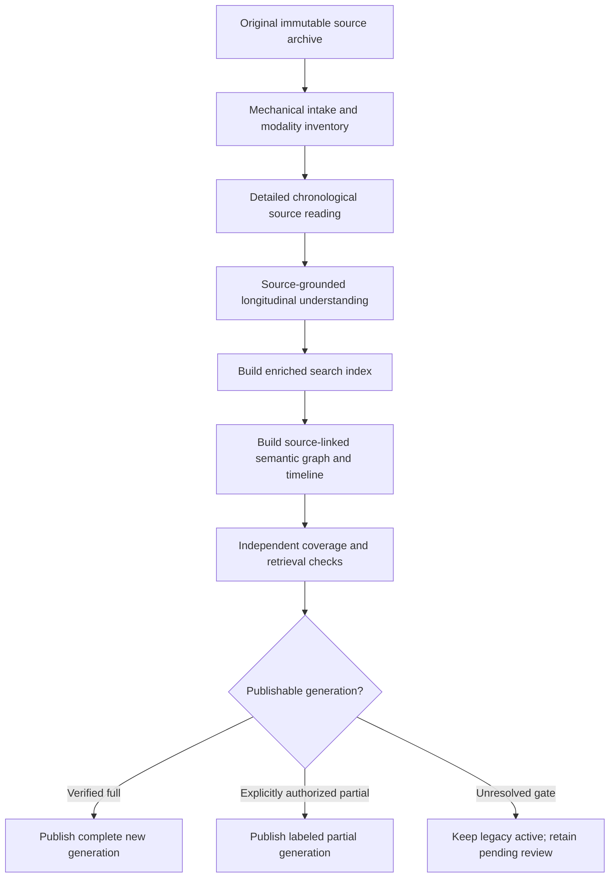

# Reading-first journal import order — owner-directed architecture revision

**Status:** OWNER ORDER ACCEPTED / EXECUTION CANDIDATE / NOT DEPLOYED.
**Owner source (18 October 2026):** “and i'm thinking the index and graph should be built AFTER the detialed reading to maek them more complete and useful also can you fix that order”.
**Parent tasks:** #183 (deep reading plus unresolved source review); #168 (existing pointer graph and live case continuity). This changes the **new-generation build order**; it does not delete or deprecate the already-published lookup until its replacement is verified.

## 1. Correct pipeline

**No production-search-index generation, person/topic/event pointer graph, timeline or publication should precede the source-reading and comprehension phase for that generation.** In particular, **not** `archive → build-quotes → pointer-pass → interpret some retrieved snippets`.

### Allowed before reading
- File integrity, format detection, raw page positions, content extraction needed to *present pages to the reader*, page/image/media inventory, source-local offset manifests and resumable source segmentation.
- Temporary private navigation within the reader to seek source passages. Such navigation is **not** the final user-facing index or evidence of comprehension.
- Existing published **legacy** exact-quote lookup continues serving users while the replacement import is prepared; never silently replace or relabel its generation.

### Reading phase
- In the original chronological sequence, inspect bounded original text and media. For every source span/page record the attempt, returned/actually-inspected bytes or modality, coverage, source provenance, timing and content status.
- Real understanding means extracting *decision-relevant source-backed observations* (not paraphrase as fact): life events and claims, context and chronology, people and relationships, authentic needs and goals, recurring patterns, exceptions and protective successes, changing circumstances, uncertainty, dreams/quotes/thoughts versus reported waking acts, medical and practical constraints.
- Compare with already established case knowledge to determine **known / new example / contradiction / new lever / changes next step**. Draft observations are not client-approved plans, diagnoses, clinical facts or medical/legal findings.
- If an original tool response is refused or media cannot be reviewed, keep `REVIEW_PENDING` with exact source status and qualified-review route. **Do not retry content-denied passages through different encodings, alternate chunk sizes, models or transports to defeat filtering.** Real consent and provider protections apply. A human review is an appropriate separate authorized channel when warranted.

### Trusted reading evidence and authority boundary

The new `reading-first-order.mjs` validator (draft PR #184) requires each stage transition to carry an HMAC-authenticated receipt from an **independent trusted private stage runner**. The reading receipt includes **every page's original-source digest, expected and actually reviewed modalities, read-result evidence digest, generation and per-page status**. A missing/forged signature, a changed source/page/generation, or text-only inspection of an image-bearing page fails the complete-reading transition. Source inventory receipts are likewise authenticated. Raw reading payloads and private attestation keys must never be placed in chat prompts, public Git/CI, telemetry or model output.

**An authenticated receipt is an attestation, not an observation of cognition.** The **real** page reader must emit it *only after* the exact archived source bytes were presented to an authorized human or permitted model and source-bound comprehension evidence was securely persisted; the trusted signer must mechanically check that delivery, output association and modality completeness first. No caller-, model- or user-supplied `actual_source_reading: true` flag or arbitrary reference proves reading. The draft helper **is not wired to the running importer yet**; signing service, protected key injection, producer receipts, actual model/human source-read provenance, source-linked synthesis and authorized publication remain implementation work. The public HMAC payload format is not permission for untrusted clients to sign or self-approve.

### Understanding phase

**Scope of known-versus-new findings:** For the first independent journal import, the `source_synthesizer` compares only original journal observations and their earlier source-linked summaries. A source-internal `known_vs_new_reconciled: true` cannot certify that the wider, pre-existing private case state was loaded or compared. The runtime explicitly labels that wider comparison `pending_separate_authorized_step`; it must be handled in a later consented case-state reconciliation, never silently upgraded to a plan/clinical priority. An unread/blank extracted page cannot produce a source anchor and is `REVIEW_PENDING` for appropriate modality inspection, not an invitation for the model to invent text.

- Reconcile adjacent batches across page and date boundaries, then run a second high-level chronology pass over the evidence records, not a replacement of original material.
- Preserve counterexamples, disagreement, changing narratives and uncertainty. A model's synthesis carries references to exact source spans and a versioned evidence state; it does not overwrite source quotes.
- Persist a private read/comprehension receipt that identifies **which original spans were actually read** and by what authorized route, which remain pending, which notes were persisted, and which reviewer/authority approved promotion.

### Downstream search index and graph
- **Only after** the reading/comprehension checkpoint may the new index be built. It indexes **both** exact original excerpts and verified source-linked understanding, including temporal qualifiers and semantic navigation facets; never index a model's ungrounded label as the original person's words.
- **Only after** the index may the graph be built. It uses the richer read-derived entities/events/relationships, contextual links, contradictions, time changes and source references, but preserves hedge, actor, provenance and dream/hypothetical status. Graph pointers never replace the original.
- Test retrieval of questions requiring material found far apart in the original, including a change over time and a counterexample that a keyword-first map could miss. A downstream graph that produces more nodes but fails these tests is not a better result.

## 2. Contract for generation transitions

| Stage | Required input | Exit evidence | Disallowed shortcut |
| --- | --- | --- | --- |
| `SOURCE_STAGED` | Authorized immutable source | Hash, parser inventory, source/page/media manifest | Claim indexed or understood |
| `READING` | Inventory, source access | Span-by-span actual-reading receipts and explicit pending media/refusals | Count parsing, keyword hits or prompt presence as reading |
| `LONGITUDINAL_SYNTHESIZED` | Reading receipts, existing permitted case history | Source-grounded observations, chronology, counterexamples, source-pointer completeness, honest pending coverage | Promote extracted labels to factual or clinical authority |
| `INDEX_BUILT` | Valid detailed-reading + synthesis receipt for this source version | Searchable generation with exact-source and read-derived facets | Build merely because `SOURCE_STAGED` passed |
| `GRAPH_BUILT` | Same generation's enriched index | Source-faithful graph/timeline linked to reviewed spans | Build only from raw tag words or stale-generation references |
| `VALIDATED` | Index + graph | Compared to index-only baseline on synthetic held-out chronology/contradiction cases; privacy and referential integrity pass | Self-certify from summaries or mere tag counts |
| `PUBLISHED` | Verified exact generation, appropriate authority | Published lookup actually finds source-backed material; rollback retained | Replace legacy with a poorer/stale incomplete generation |

**Strictness:** An incomplete source review may yield a *clearly named provisional* downstream index/graph **only by an explicit authorized publication decision**, limited to reviewed source with permanent visibility of outstanding spans. Neither a tool refusal nor partial user visibility requires suspending the existing published index. **A complete new generation requires every source modality to have a completed, authorized review disposition.** This qualification is not a license to omit unknown content.

## 3. Migration of the already-running journal

**New-generation default with legacy resume protection:** In this development candidate, an import with **no saved checkpoint and no explicit setting** now starts in `reading_first` mode. A persisted generation keeps its saved order; a historical state lacking the `import_order` field is treated as `legacy_quote_first`, and a conflicting explicit order is refused rather than rewriting a running generation. Operators can explicitly choose `legacy_quote_first` for existing tests/compatibility. This change is **not yet merged, installed, deployed or a published index**; the installed runtime still uses its existing behavior until owner-authorized release.

1. The existing fast quote-index generation and staged pointer-tag pass stay intact and queryable during migration. Do not interrupt the running worker, reset the encrypted corpus, lose the existing 20k tag investment, republish an older quote generation or start the abandoned slow semantic calibration.
2. Privately load the current source/modality coverage ledger and **first** resolve as many remaining original text/media gaps as permitted; retain unsupported segments as pending, not negative evidence.
3. Produce the missing full-source, page-linked detailed-reading/synthesis layer. On an explicit owner-approved partial mode, any proposed interim index/graph is scoped only to appropriately reviewed material with visible pending ranges.
4. Reuse exact quotation spans, dates, stable source references and already-grounded tags whenever they survive the newly read context. Remap v2/v3/v4 ids by original source span rather than guessing or rerunning thousands of tags solely to change an identifier.
5. Rebuild/refine and measure the **replacement index and graph AFTER** the comprehension layer; publish one exact reviewed generation under project release gates. Old lookup remains until its replacement works in a fresh authorized connector session.

## 4. Acceptance (regression design, synthetic only)

1. A mixed, chronological invented journal has early cause, later reversal, multiple competing explanations, a dream/real-event distinction and a protective success; the importer reads all accessible source first, then indexes **these learned distinctions**, then graphs them. A question spanning distant source pages retrieves the supported evolution, not only nearby keyword matches.
2. Running `build-quotes`, pointer generation, graph build or publication early against a **new reading-first generation** fails with the same stable `READING_STAGE_INCOMPLETE` / `SYNTHESIS_STAGE_INCOMPLETE` status; it does not silently fall back to quote-first ordering.
3. A denied text batch and an image-only page remain `REVIEW_PENDING`; no fabricated fully-read status. The existing published index continues to work while new complete generation is blocked.
4. Process interruption after 70% detailed reading: restart resumes exactly from the protected source ledger without duplicating source observations, and does not execute an index/graph phase before reading catches up.
5. A cross-document contradiction creates distinct source-grounded claims with time and actor qualifiers; graph must not assert an invented objective event. Source changes invalidate downstream index/graph lineage. No private source appears in public tests, CI, Git or dispatch telemetry.
6. The final acceptance is **working import behavior and improved retrieval/longitudinal understanding**, not just a design, GitHub issue, queue marker or a green unit test of an unconnected helper.

## 5. Work division and release

- **Chat/reasoning:** owns substantive reading/synthesis method, quality judgments and exact task directives.
- **Codex/worker:** implements stages, stores source-scoped evidence, adds synthetic tests, validates and builds a reviewable PR; no self-authorization to release.
- **Qualified reviewer/owner:** owns sensitive-source access, legal/clinical/privacy decisions and publication gates when actually required.

The code already includes mechanical `buildQuotes` and `pointerRun` paths that only require archived parsed source (`src/journal-import/private-runtime.mjs`). They currently violate this new order for **new reading-first generations** and must be integrated with the read/synthesis receipt gate, not merely relabeled. The existing branch/installed runtime is unchanged by this document. The owner outcome is **OPEN** until the actual importer obeys the sequence and a fresh authorized import demonstrates it.

## 6. Authorized review route (28 Oct 2026)

**Status:** IMPLEMENTATION CANDIDATE on a task branch / NOT DEPLOYED. This section adds the "separate authorized channel" that §1 already allows ("a human review is an appropriate separate authorized channel"; a page's source is presented "to an authorized human or permitted model"). It changes how the importer treats a page it cannot read; it adds no owner decision, and the rules of §1 and §2 are unchanged: no page is counted as read without verified evidence, every page is read or reviewed before any index is built, and the receipts are attested only by the runtime's own key.

### 6.1 What went wrong without it

1. A page with a picture, no extractable text, or a refused reading became `REVIEW_PENDING`, yet `read-source` still synthesized and signed receipts. From then on `read-source` returned early, so nothing could ever be added to that page and `build-quotes` stayed blocked.
2. One bad model answer for one page (a quotation not in the page, an invalid output) ended the run, and because the answer is stored durably every rerun ended the same way.
3. A model that did not answer a page held the run for two 24 hour item lifetimes.
4. A new execution root published into a new `corpus:<uuid>:quotes` corpus, so a case ended up with two quote corpora and no way to say which one the connector should search.

### 6.2 The route

`read-source` sends a page to the source reader only when it is a text page with text that no reviewer was given. Every other page, and every page the reader cannot read, is `REVIEW_PENDING` with a reason, and **while any page is pending nothing is synthesized and nothing is signed**. The run returns `status: REVIEW_PENDING`, the counts (`source_pages`, `read`, `operator_reviewed`, `pending`) and the pending pages by number and reason. It keeps no `reading_first_receipts_ref`, so `read-source` can run again, and `build-quotes`, the pointer pass and pointer publication fail with `JOURNAL_READING_FIRST_REVIEW_PENDING` until it has finished.

| Reason | Page |
| --- | --- |
| `visual_pending` | has a picture (`image` or `text+image`); the reader is text only |
| `source_unavailable` | text page with no text; an empty extraction is not comprehension |
| `operator_review_requested` | named in `operator_read_pages`; never sent to the reader |
| `tool_refused` | the reader's tool refused it; it is not retried (as before) |
| `reader_output_invalid` | the reader's answer did not have the required structure (`INVALID_STRUCTURED_OUTPUT`) |
| `reader_evidence_invalid` | the answer was well formed but failed the source checks (a quotation not in the page, missing anchors or findings, a page or digest that does not match); nothing from it is kept |
| `reader_unavailable` | the reader could not be asked or did not answer within its limits (`INFERENCE_RETRY_LIMIT`, `JOURNAL_EXCHANGE_RETRY_LIMIT`, an exhausted item, a page or work packet too large) |

Every other failure is still fatal exactly as before: an unknown completion (`COMPLETION_UNKNOWN`), an unavailable exchange, authorization or grant errors, a completion the runtime cannot verify (`JOURNAL_READING_FIRST_RECEIPT_NOT_TRUSTED`) and persistence failures. A page is never marked pending to get past a problem that is not about the page.

When a run ends pending, it writes the **worklist**, `<operator_review_dir>/reading-first-review-worklist.json` (owner-only, replaced atomically): `{ schema_version, source_sha256, generation, pages: [{ page, source_page_sha256, required_modalities, reason, text }] }`. `text` is the importer's exact text of the page, so a reviewer quotes what the importer will check against. The run state and `status` carry the pages and reasons, never text. The worklist holds journal text and is removed when no page is pending.

The reviewer writes the **review bundle**, `<operator_review_dir>/reading-first-reviews.json`, and `read-source` is run again. A rerun replays the reader's stored answers (no new model call for a page already answered), applies the reviews, and finishes when no page is pending.

### 6.3 Files and settings

| Name | Where | Notes |
| --- | --- | --- |
| `operator_review_dir` | run config (existing key, also used by `pointer-examples`) | absolute, owner-only directory outside the repository, checked as `pointer-examples` checks it; if unset no bundle is read and no worklist is written |
| `reading-first-reviews.json` | `operator_review_dir` | the reviewer's input; a regular file (opened without following links), mode with no group or other bits, at most 32 MiB, valid JSON |
| `reading-first-review-worklist.json` | `operator_review_dir` | the importer's output, as above |
| `operator_read_pages` | run config | unique positive page numbers given to a reviewer instead of the reader; needs `operator_review_dir` (`JOURNAL_OPERATOR_REVIEW_DIR_REQUIRED`); a number past the last page is refused once the inventory is known (`JOURNAL_OPERATOR_READ_PAGES_INVALID`) |
| `semantic_concurrency` | run config (existing key) | now also the number of pages with the reader at once (1 to 8, default 1); results are still handled strictly in page order, so what is verified, kept and left pending does not depend on it; a page that ends the run with a fatal error first waits for the calls already started, so the runtime is not closed under a call that is still writing its answer (those answers are kept for the next run) |
| `reading-first-progress.json` | execution root | owner-only, replaced atomically, page numbers and counts only (`waiting_on_page`, `through_page`, `read`, `operator_reviewed`, `pending`, `updated_at`); `status` shows it as `reading_first_progress` |
| `replaces_published_quotes` | run config | see 6.6 |

Bundle schema, strict at every level (a key it does not name is refused): `{ schema_version: 1, source_sha256, reviewer (1..200), authorization_ref (1..320), reviews: [...] }` with at most one review per page and no more reviews than pages. A review is `{ page, source_page_sha256, reviewed_modalities, source_read_complete: true, image_content_reviewed, source_specific_understanding (1..2500), exact_source_anchors, source_findings, reviewer? }`: anchors and findings have the reader's shapes and bounds, `image_content_reviewed: true` is required exactly when `reviewed_modalities` contains `image` and must be absent otherwise, and an optional `reviewer` (1..200) replaces the bundle's for that page only, so pages reviewed by different people or models are recorded accurately.

### 6.4 What the importer checks, and what it cannot

A review is bound to the inventory page: `page`, `source_page_sha256` and `reviewed_modalities` must equal the importer's own. For a page with text, at least one anchor and one finding are required and every anchor must be found in the page text (the same location rule as the reader's, 6.5); for a page without text both lists must be empty. Any failure ends the run with `JOURNAL_READING_FIRST_OPERATOR_REVIEW_INVALID`, before any page is sent, and the error names no page and no text. A review for a page that is not waiting for one (the reader read it) is `JOURNAL_READING_FIRST_OPERATOR_REVIEW_UNEXPECTED`, and every review must be used.

The importer cannot check that the reviewer looked at the picture or understood the page: `image_content_reviewed: true` and the understanding are the reviewer's statements. They are recorded with the reviewer and the `authorization_ref`; the protection is that only the owner of the private directory can place the file. This route does not send a page anywhere: it retries nothing through other encodings, chunk sizes, models or transports (§1), and it neither signs nor attests anything for the reviewer.

A page's evidence is kept as the reader's is (`reading-first:page:<n>` in the encrypted store), with `provenance: "authorized_operator_review"` and `review: { route, reviewer, authorization_ref, review_sha256 }`, where `review_sha256` is the digest of that one review's canonical JSON, so adding a review for another page never changes a page already kept. The page's row in the signed `READING_DISPOSITIONED` receipt is `REVIEWED_ALL_SOURCE_MODALITIES` with the importer's own `reviewed_modalities` and a new `review_route` (`source_reader` or `authorized_operator_review`). The route is inside what the runtime key signs.

**Applied reviews are immutable.** Evidence is written once; changing a review after it was applied (its text, its reviewer or the bundle's `authorization_ref`, all of which are part of the kept evidence) is refused with `JOURNAL_IMMUTABLE_RESULT_CONFLICT`, and the run signs nothing. To correct a review that was already applied, start a new execution root (6.6 carries the published corpus over). The reader's evidence for a page is kept the same way, so a page the reader has already read cannot be handed to a reviewer afterwards (the review would conflict with what is kept): take it out of `operator_read_pages` and the stored reader answer is used again. A run that signed receipts with pending pages before this route keeps them (`read-source` returns early once receipts exist), so it cannot be completed in place either; it too needs a new execution root.

### 6.5 Quotation location

For an anchor without explicit offsets the page is searched for the exact text first (overlapping matches counted). Only when there is none is it searched with a pattern in which a run of whitespace (`\s`, no-break space, narrow no-break space, thin space) matches one or more of those characters and each of the apostrophes U+0027, U+2018, U+2019 and U+02BC matches any of the four; every other character is literal. The occurrence rules are unchanged (a unique match, or the `occurrence` index), and the kept anchor text is the page's own slice, never the model's or the reviewer's spelling. Anchors with explicit `start` and `end` stay exact. This applies to the reader's evidence and to a review alike, so a line break or a typographic apostrophe in a PDF no longer leaves a page pending for a correct quotation, and a quotation that is not in the page still does.

### 6.6 Replacing the published quote corpus in place

A new execution root used to publish into a new quote corpus. With `replaces_published_quotes: { corpus_id: "corpus:<uuid v4>", generation: "<the corpus's active generation>" }` (`corpus_id` is the base id, without `:quotes`; invalid values are `JOURNAL_REPLACED_PUBLICATION_INVALID`, and doctor checks them) a **new** run takes that corpus's id, records the generation as the one it replaces (`quote_published`), and its `buildQuotes`, `publish-quotes` and `pointer-publish` publish into the same corpus: `publishJournalGenerationFromStaging` replaces that generation only while it is still the active one, keeps it among the corpus's `previous_generations`, and refuses a corpus that does not exist in the case (`JOURNAL_PUBLICATION_REPLACED_CORPUS_MISSING`) rather than create a second one. A run keeps what it began with: a later config that drops the setting or names another corpus or generation is `JOURNAL_REPLACED_PUBLICATION_CHANGED`.

A new run also archives its original as `original:source:<first 24 hex of the source's sha256>` instead of the constant `original:source`, because two sources in one corpus would otherwise collide (`JOURNAL_TRANSFER_DESTINATION_CONFLICT`). Runs that began earlier keep the constant id they have and are otherwise unchanged.

Rollback is the existing one: `rollbackJournalGeneration` through the case access service, with a `correct`-purpose grant (the documented import grant cannot roll back), to the replaced generation named in `previous_generations`.

### 6.7 Not shown by the synthetic tests

The tests use invented text, a mock inference port and a mock source parser. They show the sequence, the checks, the receipts and the replacement and rollback mechanics; they do not show how a real reader behaves on a real journal, how large a real worklist or bundle is, or that a real PDF yields the page text a reviewer was shown. A reader that stalls on one page still holds the pages after it (results are handled in page order), which is the price of keeping the result identical to sequential reading; for the same reason a fatal error waits for the calls that were already started (at most `semantic_concurrency` less one), which the port's own deadlines bound. Whether a particular page may be shown to a particular reviewer is the owner's decision, made outside this code.
