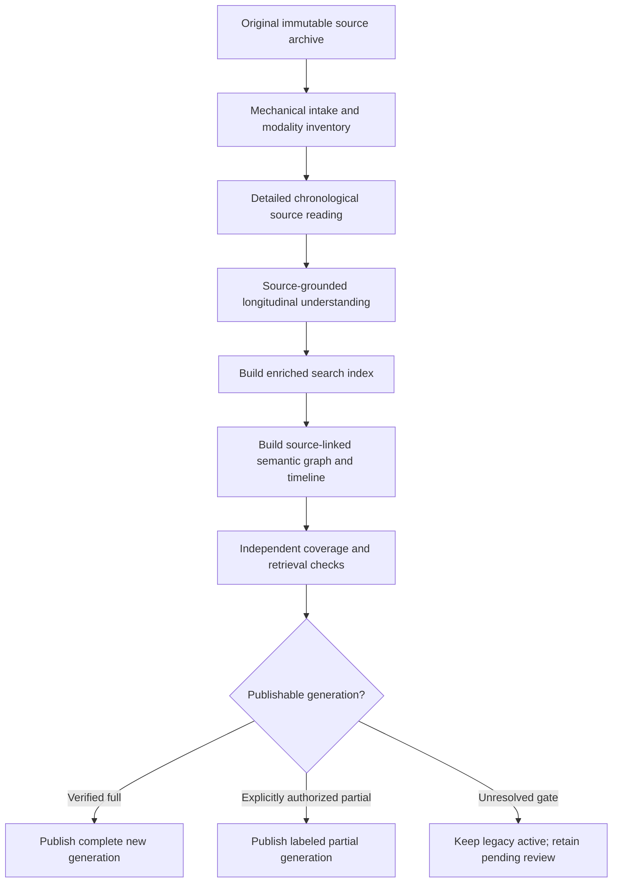

# Reading-first journal import order — owner-directed architecture revision

**Status:** OWNER ORDER ACCEPTED / EXECUTION CANDIDATE / NOT DEPLOYED.  
**Owner source (18 October 2026):** “and i'm thinking the index and graph should be built AFTER the detialed reading to maek them more complete and useful also can you fix that order”.  
**Parent tasks:** #183 (deep reading plus unresolved source review); #168 (existing pointer graph and live case continuity). This changes the **new-generation build order**; it does not delete or deprecate the already-published lookup until its replacement is verified.

## 1. Correct pipeline

**No production-search-index generation, person/topic/event pointer graph, timeline or publication should precede the source-reading and comprehension phase for that generation.** In particular, **not** `archive → build-quotes → pointer-pass → interpret some retrieved snippets`.

### Allowed before reading
- File integrity, format detection, raw page positions, content extraction needed to *present pages to the reader*, page/image/media inventory, source-local offset manifests and resumable source segmentation.
- Temporary private navigation within the reader to seek source passages. Such navigation is **not** the final user-facing index or evidence of comprehension.
- Existing published **legacy** exact-quote lookup continues serving users while the replacement import is prepared; never silently replace or relabel its generation.

### Reading phase
- In the original chronological sequence, inspect bounded original text and media. For every source span/page record the attempt, returned/actually-inspected bytes or modality, coverage, source provenance, timing and content status.
- Real understanding means extracting *decision-relevant source-backed observations* (not paraphrase as fact): life events and claims, context and chronology, people and relationships, authentic needs and goals, recurring patterns, exceptions and protective successes, changing circumstances, uncertainty, dreams/quotes/thoughts versus reported waking acts, medical and practical constraints.
- Compare with already established case knowledge to determine **known / new example / contradiction / new lever / changes next step**. Draft observations are not client-approved plans, diagnoses, clinical facts or medical/legal findings.
- If an original tool response is refused or media cannot be reviewed, keep `REVIEW_PENDING` with exact source status and qualified-review route. **Do not retry content-denied passages through different encodings, alternate chunk sizes, models or transports to defeat filtering.** Real consent and provider protections apply. A human review is an appropriate separate authorized channel when warranted.

### Understanding phase
- Reconcile adjacent batches across page and date boundaries, then run a second high-level chronology pass over the evidence records, not a replacement of original material.
- Preserve counterexamples, disagreement, changing narratives and uncertainty. A model's synthesis carries references to exact source spans and a versioned evidence state; it does not overwrite source quotes.
- Persist a private read/comprehension receipt that identifies **which original spans were actually read** and by what authorized route, which remain pending, which notes were persisted, and which reviewer/authority approved promotion.

### Downstream search index and graph
- **Only after** the reading/comprehension checkpoint may the new index be built. It indexes **both** exact original excerpts and verified source-linked understanding, including temporal qualifiers and semantic navigation facets; never index a model's ungrounded label as the original person's words.
- **Only after** the index may the graph be built. It uses the richer read-derived entities/events/relationships, contextual links, contradictions, time changes and source references, but preserves hedge, actor, provenance and dream/hypothetical status. Graph pointers never replace the original.
- Test retrieval of questions requiring material found far apart in the original, including a change over time and a counterexample that a keyword-first map could miss. A downstream graph that produces more nodes but fails these tests is not a better result.

## 2. Contract for generation transitions

| Stage | Required input | Exit evidence | Disallowed shortcut |
| --- | --- | --- | --- |
| `SOURCE_STAGED` | Authorized immutable source | Hash, parser inventory, source/page/media manifest | Claim indexed or understood |
| `READING` | Inventory, source access | Span-by-span actual-reading receipts and explicit pending media/refusals | Count parsing, keyword hits or prompt presence as reading |
| `LONGITUDINAL_SYNTHESIZED` | Reading receipts, existing permitted case history | Source-grounded observations, chronology, counterexamples, source-pointer completeness, honest pending coverage | Promote extracted labels to factual or clinical authority |
| `INDEX_BUILT` | Valid detailed-reading + synthesis receipt for this source version | Searchable generation with exact-source and read-derived facets | Build merely because `SOURCE_STAGED` passed |
| `GRAPH_BUILT` | Same generation's enriched index | Source-faithful graph/timeline linked to reviewed spans | Build only from raw tag words or stale-generation references |
| `VALIDATED` | Index + graph | Compared to index-only baseline on synthetic held-out chronology/contradiction cases; privacy and referential integrity pass | Self-certify from summaries or mere tag counts |
| `PUBLISHED` | Verified exact generation, appropriate authority | Published lookup actually finds source-backed material; rollback retained | Replace legacy with a poorer/stale incomplete generation |

**Strictness:** An incomplete source review may yield a *clearly named provisional* downstream index/graph **only by an explicit authorized publication decision**, limited to reviewed source with permanent visibility of outstanding spans. Neither a tool refusal nor partial user visibility requires suspending the existing published index. **A complete new generation requires every source modality to have a completed, authorized review disposition.** This qualification is not a license to omit unknown content.

## 3. Migration of the already-running journal

1. The existing fast quote-index generation and staged pointer-tag pass stay intact and queryable during migration. Do not interrupt the running worker, reset the encrypted corpus, lose the existing 20k tag investment, republish an older quote generation or start the abandoned slow semantic calibration.
2. Privately load the current source/modality coverage ledger and **first** resolve as many remaining original text/media gaps as permitted; retain unsupported segments as pending, not negative evidence.
3. Produce the missing full-source, page-linked detailed-reading/synthesis layer. On an explicit owner-approved partial mode, any proposed interim index/graph is scoped only to appropriately reviewed material with visible pending ranges.
4. Reuse exact quotation spans, dates, stable source references and already-grounded tags whenever they survive the newly read context. Remap v2/v3/v4 ids by original source span rather than guessing or rerunning thousands of tags solely to change an identifier.
5. Rebuild/refine and measure the **replacement index and graph AFTER** the comprehension layer; publish one exact reviewed generation under project release gates. Old lookup remains until its replacement works in a fresh authorized connector session.

## 4. Acceptance (regression design, synthetic only)

1. A mixed, chronological invented journal has early cause, later reversal, multiple competing explanations, a dream/real-event distinction and a protective success; the importer reads all accessible source first, then indexes **these learned distinctions**, then graphs them. A question spanning distant source pages retrieves the supported evolution, not only nearby keyword matches.
2. Running `build-quotes`, pointer generation, graph build or publication early against a **new reading-first generation** fails with the same stable `READING_STAGE_INCOMPLETE` / `SYNTHESIS_STAGE_INCOMPLETE` status; it does not silently fall back to quote-first ordering.
3. A denied text batch and an image-only page remain `REVIEW_PENDING`; no fabricated fully-read status. The existing published index continues to work while new complete generation is blocked.
4. Process interruption after 70% detailed reading: restart resumes exactly from the protected source ledger without duplicating source observations, and does not execute an index/graph phase before reading catches up.
5. A cross-document contradiction creates distinct source-grounded claims with time and actor qualifiers; graph must not assert an invented objective event. Source changes invalidate downstream index/graph lineage. No private source appears in public tests, CI, Git or dispatch telemetry.
6. The final acceptance is **working import behavior and improved retrieval/longitudinal understanding**, not just a design, GitHub issue, queue marker or a green unit test of an unconnected helper.

## 5. Work division and release

- **Chat/reasoning:** owns substantive reading/synthesis method, quality judgments and exact task directives.
- **Codex/worker:** implements stages, stores source-scoped evidence, adds synthetic tests, validates and builds a reviewable PR; no self-authorization to release.
- **Qualified reviewer/owner:** owns sensitive-source access, legal/clinical/privacy decisions and publication gates when actually required.

The code already includes mechanical `buildQuotes` and `pointerRun` paths that only require archived parsed source (`src/journal-import/private-runtime.mjs`). They currently violate this new order for **new reading-first generations** and must be integrated with the read/synthesis receipt gate, not merely relabeled. The existing branch/installed runtime is unchanged by this document. The owner outcome is **OPEN** until the actual importer obeys the sequence and a fresh authorized import demonstrates it.
