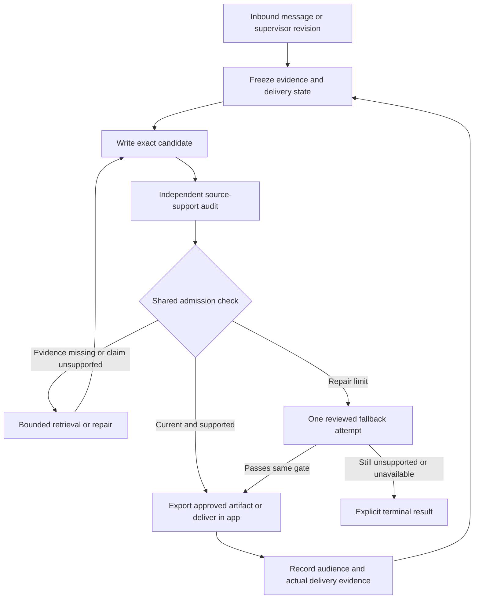

# Mechanical enforcement of response evidence

Status: **proposed architecture; no runtime enforcement is installed by this document**.

Date: 26 October 2026. Source baseline: development `09a0f5af80fbf80ea985ce49347a7d66565d546d`. Tracked outcome: [enforcement issue #195](https://github.com/u-dont-existDOTcom/innerSignalGraph/issues/195). Implementation sequence: [companion plan](../plans/2026-10-26-response-evidence-enforcement.md). Recovery: [task checkpoint](../../../tasks/response-evidence-enforcement-20261026/INTEGRATION.md).

## 1. Decision and intended result

Extend InnerSignal's existing candidate lifecycle with a **server-created response-evidence snapshot**, an explicit source-support report from the existing independent auditor, and a shared admission check at the authoritative approval/export/delivery operations.

A reply must not be approved merely because its writer or auditor says that history was checked. The server must know which source material it supplied, what was actually sent to which audience, which exact candidate was reviewed, and whether the relevant facts remain current. The auditor must assess whether the wording and the personalized advice are supported by that material.

The result has two parts:

1. **Application runtime:** automatic replies, repaired replies, and fallback questions cross the same controlled boundary.
2. **Supervisor drafting:** the approved artifact exported for a client crosses that boundary too. Displaying a draft to the supervisor is not client delivery. The current read-only MCP cannot prevent an external host from producing arbitrary text; the architecture must not claim otherwise.

This is an execution and evidence-control change. It does not change the therapeutic map, prescribe new treatment policy, require rereading an entire journal for each response, or depend on completion of an unfinished journal import.

### Requirements and why they exist

| Requirement | Origin | What fails without it | Smallest sufficient control |
| --- | --- | --- | --- |
| Actual delivery state, distinct from drafts | Owner correction / issue #195 | An unsent suggestion becomes assumed shared history | Typed delivery evidence, audience, exact text identity |
| Relevant history before history-dependent advice | Owner correction / issue #195 | Generic advice ignores already known experience | Source-bounded prior turns or authorized journal retrieval; explicit uncertainty when unavailable |
| Exact reviewed output | Existing candidate lifecycle | A repair or translation inherits approval of different wording | Candidate ID/version/hash and fresh audit |
| Enforce on every owned exit | Necessary to the above outcomes | Alternate delivery/fallback methods bypass a correct helper | One shared predicate at store operations and export |
| Preserve support with missing history | Issue #195 and existing safety boundaries | An outage prevents useful current-message support | Narrow claim repair, current-context response, or a neutral question |
| Protect private source material | Existing repository and storage contract | Receipts, logs, or a new tool expose case data | Existing authorization and encrypted store; public diagnostics remain content-free |
| New database, full event-sourcing platform, universal claim ontology | Not necessary | No demonstrated owner gap requires them | Do not add them |
| More independent auditors by default | Not necessary | Existing auditor can receive a stronger contract | Reuse the existing independent role; evaluate detection before adding complexity |

## 2. What the current source already provides

These are source observations at the baseline, not deployment readbacks.

| Source | Existing behavior | Gap to close |
| --- | --- | --- |
| `src/supervisor/private-therapy-turn-controller.mjs` | Persists inbound/candidate/audit/repair/delivery stages. When a journal provider exists, freezes its bounded packet and reuses it after restart | Provider defaults to `null`; no required explicit history disposition or delivery-evidence snapshot |
| `src/supervisor/private-therapy-model-runtime.mjs` | Supplies the frozen journal packet to writer, audit, and repair; auditor has fresh packet-only context | Case context is separately reloaded; evidence source identity and delivery assertions need a common frozen contract |
| `src/supervisor/private-candidate-audit.mjs` | Resolves exact candidate and recent verbatim; persists version-bound audit | No mandatory source-specific support or actual-delivery coverage |
| `src/supervisor/private-candidate-lifecycle.mjs` | Binds audit to exact candidate/version/hash, independence, findings, and repair checks | Valid empty findings can pass without proving the new dimensions were examined |
| `src/schemas/private-runtime.mjs` | Strict structured audit with findings and repair checks | Extend the existing schema rather than accept a free-form “history checked” flag |
| `src/storage/private-case-store.mjs` | Encrypted mutation, immutable candidate bytes, append-only transcript, atomic transcript-bound delivery | `markCandidateSent` is status-only; runtime delivery and `candidateDeliveryCompletion` use different evidence projections |
| `src/storage/private-case-access.mjs` | Case scope and journal-purpose checks precede access | New retrieval/export adapters must preserve those checks; corpus existence is not session-use permission |
| `src/journal-import/retrieval.mjs` | Snapshot/generation/visibility checks, exact source excerpts, bounded search and coverage metadata | Add trusted per-turn retrieval receipts and source-resolution links to the frozen packet |
| `src/storage/shared-case-coordinator.mjs` | In-process case serialization and a Linux private-root writer lock | All new writers must use the existing process-owner/lock path; an in-process queue alone is insufficient |
| `src/server/private-case-mcp.mjs` | Read-only therapy continuity and protocol tools | No owned interception of host-written replies and no client-delivery mutation |

### Existing inconsistencies to repair, not reproduce

`deliverCandidateResponse` binds an assistant transcript entry, the exact latest inbound turn, candidate version, and approving audit in one mutation. `deliverPrivateRuntimeCandidate` also creates an exact transcript entry and runtime delivery record, but does not populate `sent_turn_id` and `sent_in_reply_to_turn_id`, which `candidateDeliveryCompletion` expects. `markCandidateSent` supplies neither transcript nor recipient proof. Normalize the evidence projection and preserve the strength of each source; do not infer stronger proof from the common `sent` label.

The normal controller constructs audit evidence directly. It does not use the standalone `persistPrivateCandidateAuditResult` wrapper. A check added only to that wrapper would miss ordinary runtime turns.

The final discriminator is taken from the current episode's question. It has existing role/belief and compatibility guards, but its one-question shape is not evidence of sound historical premises. Questions require evidence review too.

Related proposal [historical-delivery PR #139](https://github.com/u-dont-existDOTcom/innerSignalGraph/pull/139) already distinguishes owner-supplied historical delivery from retrospective audit approval. It remains unmerged at this baseline. Reuse its principle after reconciliation; do not assume its code is installed or merge its unrelated state blindly.

## 3. End-to-end control flow

All elements below marked as new are proposed. The existing writer/auditor/repair lifecycle remains the execution backbone.



The fallback branch has its own terminal bound: one audited fallback attempt after the existing two repair cycles. Failure stops that candidate; it does not loop through another repair campaign. Optional journal retrieval must not delay a response warranted by the current message. This is a scheduling/claim-scope requirement, not a claim that the baseline has a separate offline emergency-response service.

### Before writing

The controller opens the authorized case, selects the exact inbound client turn or separately typed supervisor revision, resolves the effective transcript including amendments, and loads the relevant established case plan and prior answers. It then decides which historical questions matter to this response, retrieves bounded supporting sources when permitted, and freezes the packet.

The writer sees clearly separated **client communication**, **supervisor-only material**, **exact historical sources**, **current reports**, and **model proposals**. These distinctions survive compaction and handoff in structured data; they are not just headings in a prompt.

### Before approval and export/delivery

The gate reloads the trusted current bindings, checks the exact candidate and audit report, checks any changed delivery/source/authorization state, and admits only the exact artifact reviewed. A final edit, a translated client message, or a changed final question produces different bytes and cannot inherit the previous approval.

## 4. Delivery is an evidence-backed fact with a scope

Do not encode the whole distinction as one boolean. Use a delivery record with independent dimensions:

| Dimension | Proposed values / meaning |
| --- | --- |
| Audience | `client`, `supervisor`; bound to the case/channel by the trusted service |
| Artifact lifecycle | Draft, superseded draft, reviewed artifact, exported artifact |
| Delivery evidence | `none`, `owner_reported_sent`, `application_persisted`, `transport_acknowledged`, `recipient_acknowledged` |
| Text identity | Candidate ID/version and exact client-message hash, or immutable imported source artifact |
| Reply relation | The client inbound turn it responds to, where known |
| Observation provenance | Authenticated reporter/adapter, source message or transport event, recorded time |
| Event time | Actual/reported send time if known; otherwise explicitly unavailable |

These evidence types are not all equivalent. An app transcript commit proves that the app committed an output; it does not prove a human read it. A transport acknowledgement proves only what that transport acknowledges. A supervisor's explicit report of sending a message supports ordinary follow-up while retaining that reported provenance.

**One explicit, unambiguous “I sent that” is sufficient to record owner-reported sending.** Do not demand a second routine confirmation. Resolve “that” against the exact visible client-language draft/version and the authenticated owner's message. If multiple versions make it genuinely ambiguous, retain unresolved identity; use the owner-supplied exact sent text if available. Never infer sending from “looks good,” approval, copying, export, or a subsequent assistant discussion.

Account authentication and authorship of a report are separate facts. `recordReportedDelivery` binds an exact trusted user-message event or a deliberate owner UI/operator action. If a host exposes only an agent-relayed report, retain that weaker origin and the quoted source with actor-resolution status; do not silently promote a model-supplied `owner_reported_sent` field into a verified owner event. Use an already available unambiguous owner statement without asking the owner to repeat it. Where the transport cannot attest the source author, preserve reported uncertainty and do not claim a stronger mechanical guarantee. A host-attestation service is not a prerequisite for the whole feature.

An English translation for the supervisor is a companion artifact with a different audience. Exporting or discussing it must not mark it as the message delivered to the client.

Source transcript roles do not by themselves establish audience: an `assistant` entry may have been shown only to a supervisor. Imported historical material must carry origin and audience or remain unknown. A quoted client response provides evidence of the quoted content only; it is not proof that every sentence of a prior draft was delivered.

### Storage and corrections

Extend the existing encrypted case record with bounded append-only communication events or equivalent typed records. Keep immutable sent text and append corrections/retractions with explicit supersession. Do not silently relabel drafts or overwrite historical evidence. The projection used in a response is derived from those records by trusted code.

Retain `markCandidateSent` only as an explicitly labeled legacy/operator status transition during migration. It must neither produce confirmed client-delivery evidence nor bypass the new gate for new candidates. New normal paths use the unified transcript/audience-bound operation. Existing historical replies remain history even if they lack current audit receipts; the new policy must not fabricate retroactive approval.

## 5. ResponseEvidenceSnapshotV1

Create one immutable snapshot per candidate lineage, with controlled revisions when material new evidence is deliberately added. Persist it in the existing encrypted record before any dependent model call. Models may request sources; they cannot mint authoritative receipts, choose their own access rights, or declare their own input trusted.

The following is a proposed field contract, not an existing API:

```text
ResponseEvidenceSnapshotV1
  id, policy_version, case_id, runtime_turn_id
  candidate_origin: backend_produced | external_draft
  original_writer_source_inclusion: verified | not_attested
  inbound: { turn_id, exact_text_sha256, audience, source_kind }
  dependency_binding:
    effective_transcript_digest
    communication_projection_digest
    established_case_context_digest
    source_authority_digest
    relevant_corpus_bindings[]
  source_items[]:
    id, kind, actor, audience, time_or_interval, epistemic_status
    exact_excerpt, excerpt_sha256, immutable_source_locator
    source_version, effective_amendment_binding
  communication_projection:
    confirmed_or_reported_client_outbound[]
    supervisor_only_artifacts[]
    unresolved_delivery[]
  history_requirements[]:
    topic_or_decision, why_material, source_ids, disposition
  journal:
    availability, retrieval_status, retrieval_receipts[]
    coverage, more_available, omissions, budget_used
  snapshot_sha256
```

Use the project's existing deterministic serialization/hash convention, with an explicit version; hash the full typed payload except the hash field. Validate immutable UTF-8 source spans against their canonical representations. No ad hoc whitespace or Unicode normalization may change evidence identity. An opaque ID or hash alone is insufficient: the relevant source excerpt must have been included in the model's actual request.

### Authority and observation provenance

Kinds distinguish exact client turn, owner report, exact journal quotation, verified historical source, model-derived summary, and unsent draft. A journal report is evidence that the person wrote that account; it is not independent verification of every external event described. Preserve subject, event time versus writing time, uncertainty, and contradiction.

Reuse `src/case-state/evidence-authority.mjs`. The candidate's newly generated formulation/state updates are **not** new historical sources for its own audit. Freeze established context before production; show any proposed updates separately. Otherwise a writer could invent a fact, persist it in case state, and have the auditor treat that update as corroboration.

### What a retrieval receipt proves

The trusted retrieval adapter records case/corpus, generation, visibility epoch, authorized purpose, retrieval operation ID, bounded query and filters, returned source IDs/locators, packet digest, and actual omission/coverage/budget information. It also binds the included evidence to the provider request assembly. Keep query text, excerpts and private-derived hashes private.

The receipt proves retrieval and inclusion in the identified server-assembled request. It does **not** prove that the model attended to the excerpt, understood it, or represented it correctly. Semantic review owns that remaining question.

For a backend-produced candidate, bind the writer's and auditor's source inclusion. For an externally submitted draft, the server attests the exact draft received and the sources supplied to its auditor; original-writer inclusion is `not_attested`. A full independent source-support audit can still approve supported exact wording. A repair is needed only when the content requires one, not merely to manufacture a writer-exposure receipt. Never claim backend writer provenance for external text. Claims that the original external author personally consulted a source need their own support or must be removed/qualified.

Do not use a writer-supplied JSON receipt as authority. Resolve receipt IDs in the server's trusted store. A digest checks identity, not authenticity by itself. Existing authenticated controller events and encrypted storage are sufficient for the initial implementation; a separate signing service is not required merely to authenticate the server to itself.

## 6. Retrieve history for the decision being made

The required behavior is to consult available, relevant history before advice materially depends on it. Calling a search tool with an irrelevant query does not satisfy that behavior.

For a proposed personalized recommendation, record the decision-relevant question: for example, whether this method was previously attempted, what happened, or which barrier made it impractical. First use exact current/prior client turns already supplied. Retrieve additional authorized journal excerpts only when those turns do not settle the relevant question. The existing case plan guides relevance but is not a substitute for source evidence.

A claim-free-looking sentence can still give poor advice by ignoring history. Consequently, the audit covers **history-dependent recommendations** as well as explicit historical assertions. Renaming advice “general information” does not exempt personalized instructions addressed to the client.

The history requirements are proposed by the planner/controller from current focus and known evidence. The independent auditor must independently inspect the entire response for missing material requirements. No producer flag such as `history_not_needed: true` can exempt text from that review.

### Availability and retrieval outcomes

Keep availability distinct from search results:

| State | What it permits |
| --- | --- |
| No configured provider / no authorization / source unavailable | Current-message support and qualified uncertainty; no claim of journal consultation |
| Relevant exact prior turns suffice | Supported history-based reasoning without an unnecessary journal query |
| Authorized retrieval, relevant excerpts returned | Source-bounded claims and recommendations within those excerpts' scope |
| Search completed with no match | “No relevant passage was found in this search,” never “it never happened” |
| Partial or capped result | Limited claims with visible internal coverage; no whole-corpus conclusion |
| Retrieval failed or budget exhausted | Repair affected claims, narrow the response, or ask a useful question |

Do not require every journal page to be fully processed before responding. Existing authorized published material remains usable with its known gaps. Pending, unread or unresolved pages remain explicit coverage gaps; they are not negative evidence. This architecture never retries refused source material through another route or starts a competing import.

### Authorization, context, and cost budgets

Use existing `session_use` purpose checks and case grants. Keep the provider unconfigured until the already-required source consent, publication/cold-test and release criteria for that generation are satisfied. Existence of a corpus or a query tool does not imply this authorization.

Preserve the controller's current upper bounds: at most 8,000 requested journal tokens and 64,000 serialized UTF-8 bytes, reserving the complete current episode and mandatory audit context. The implementation must count or conservatively bound the actual supplied packet; a `maximumTokens` parameter alone is not evidence of compliance. Enforce the byte cap before invoking a model. A single oversized quotation must be explicitly omitted or source-split at a valid boundary, never silently truncated or admitted above the cap.

Initial design default: one batched targeted retrieval before writing, and at most one bounded evidence expansion when an audit identifies a specific missing question. Count both against a per-turn budget; cache by case, purpose, generation, visibility epoch and query. These are conservative experimental defaults, not new clinical policy. Additional retrieval cannot reset the existing two-repair limit or become an unbounded loop.

## 7. Independent semantic audit, explicit coverage

Extend the existing private audit output with `evidence_review`. The audit reads the exact final client-language text, its frozen evidence, and the current policy. It must not receive the producer's hidden reasoning or preferred verdict.

Proposed coverage dimensions:

1. Prior-delivery assertions and presuppositions, including questions.
2. Personal historical facts, attribution, chronology and uncertainty.
3. Materially history-dependent advice and previously tried methods/barriers.
4. Claims that a journal or other source was consulted.
5. Scope of conclusions relative to retrieved coverage, and handling of conflicting sources.

For each dimension return either explicit assessed items or a justified `no_applicable_items`. For each item return an exact candidate span, claim/recommendation kind, source IDs, and one of `supported`, `contradicted`, `unsupported`, or `uncertain_but_worded_accurately`. The last option means the response actually expresses the uncertainty; it is not permission to assert an uncertain fact.

```text
EvidenceReviewV1
  candidate_id, candidate_version, candidate_sha256
  evidence_snapshot_id, evidence_snapshot_sha256, policy_version
  coverage[all five required dimensions]
  items[]:
    candidate_span { start_utf8_byte, end_utf8_byte, span_sha256 }
    kind, source_ids[], assessment, bounded_reason
  missing_material_history[]
```

Code checks field completeness, valid UTF-8 boundaries, exact span identity, existing allowed source references, compatible provenance kinds, bound receipt identity, and verdict consistency. Semantic review judges entailment, relevance, completeness and appropriate uncertainty. Do not add a writer claim manifest in the first slice; the auditor discovers items from the entire candidate. If a manifest is later introduced as an efficiency aid, it must never narrow the audit's scope.

All items admitted to these five required dimensions concern substantive source support: an `unsupported` or `contradicted` item blocks, as does every unresolved entry in `missing_material_history`. The auditor decides whether a historical dependency is relevant enough to enter that list; once entered, the server applies the fixed blocking consequence. Stylistic preferences remain in the existing ordinary findings/severity channel. No free-form “minor” label can downgrade an unsupported delivery or personal-history item. A generic PASS or empty findings array cannot override a missing required evidence report. Malformed output is an operational/schema failure, not a clinical verdict.

## 8. One shared admission predicate at the trusted boundary

Add a small shared module, proposed name `src/supervisor/response-evidence-contract.mjs`. The store invokes it with trusted persisted context; caller-supplied objects cannot replace that context.

Conceptual rule:

```text
admissible =
  existing_candidate_and_safety_gates_pass
  AND current_caller_is_authorized
  AND exact_candidate_matches_review
  AND trusted_snapshot_and_required_inclusion_receipts_match_candidate_origin
  AND current_dependencies_match_snapshot
  AND required_audit_coverage_is_present
  AND referenced_sources_and_delivery_provenance_are_valid
  AND no_unresolved_material_support_failure
```

Invoke the same checks at:

| Boundary | Required action |
| --- | --- |
| `recordCandidateAudit` | Reject structurally unsupported PASS; preserve valid FAIL evidence |
| `commitPrivateRuntimeAudit` | Same check, including sealed invocation evidence; do not trust controller-only preflight |
| `approveCandidateForDelivery` | Revalidate exact evidence/report bindings and current dependencies |
| `deliverCandidateResponse` | Atomically recheck current frontier and append exact bytes |
| `deliverPrivateRuntimeCandidate` | Same rule and normalized transcript/audience receipt |
| Legacy `markCandidateSent` | Cannot create new enforced delivery or promote status-only evidence |
| Fallback/discriminator approval and delivery | Same evidence standard for the exact fallback text |
| New supervisor export adapter | Export only the admitted artifact; export does not mark client sent |

The low-level store is the final enforcement point. Preflight in the controller is useful for faster repair and better errors, but cannot be the sole protection. Backend/operator recovery paths must have explicit semantics rather than silent bypass flags. No arbitrary “emergency=true” flag waives provenance for an otherwise fabricated reply.

### Concurrency and invalidation

A snapshot binding includes effective transcript/amendments, communication projection, established case context relevant to production, and the used journal generations/visibility epochs. Bind dependency projections, not the entire mutable record revision: writing an audit event must not invalidate its own input.

Normalize the current inbound exactly once. At this baseline `beginPrivateRuntimeTurn` stores runtime inbound, and `commitPrivateRuntimeCandidate` later appends it to the raw transcript while applying proposed state updates. The dependency projection therefore represents that same inbound by its ID/hash whether it is still in `runtime.inbound` or already in the transcript. Candidate-owned proposed extractions/state updates do not change the established-history binding or corroborate themselves; keep their proposal identity separate. Likewise, creating/auditing/exporting the current draft lineage is not a new historical communication: bind its identity separately and exclude those bookkeeping events from the historical communication digest. Independent source amendments, owner revisions, owner plan changes, new inbound turns and genuine delivery corrections still invalidate. Existing protective-compatibility bindings remain separately enforced. Test the real first candidate commit through audit and delivery so normal self-persistence cannot stale every response.

At approval and immediately before export/delivery, reauthorize and compare current dependencies under the existing mutation coordinator and private-root writer ownership. Changed inbound text, delivery corrections, source correction, revoked access, a relevant generation/visibility change, or candidate edits require a new snapshot/review. Audit timestamps and receipt bookkeeping alone do not.

Freeze model input outside long-running store locks; recheck dependencies atomically when committing. If new evidence arrives while the provider runs, its result remains preserved as stale work, not deliverable work. Retries use the same operation key and frozen packet until a deliberate superseding attempt is created. Do not swap in a newly fetched packet beneath a completed writer.

Bind recipient/audience as well as text. The same approved words cannot automatically be reused for another case or audience. Repeated delivery of the same admitted artifact is idempotent; a conflicting replay fails rather than appending twice.

## 9. Recovery without blanket refusal

When a source-sensitive item fails, repair that item and re-audit the resulting candidate. Examples include introducing a suggestion as new, qualifying an uncertain historical statement, using a known prior answer, or asking about an unresolved point without presupposing its answer.

Keep the existing maximum of two candidate repair cycles. At the limit, review one short current-context fallback using the same evidence contract. A stored `next_question` is not inherently safe: “Why did you stop following my earlier advice?” asserts prior delivery and behavior. If that fallback fails, return a concise operational status to the supervisor or use an already-authorized history-free fallback whose exact bytes and policy are controlled. Do not create a third hidden repair cycle.

Current-message urgent support must not wait for optional journal retrieval. Run the existing threat/safety policy with current-message evidence and no unsupported historical assertions. Urgency does not waive case authorization, existing safety policy, exact-output binding, or permission for unrelated claims. The baseline's safety guidance is inside its model pipeline; when that pipeline is unavailable, the server can return an operational error. This design does not pretend there is an independent offline help surface. Preserve a truthful operational status if inference or required review is unavailable. A new offline clinical fallback would be a separate policy change, not an implicit implementation step here.

## 10. The actual supervisor workflow and the host boundary

This is required to address the observed drafting failure, not an optional enhancement after the runtime is finished.

The present read-only connector can supply context and protocol but cannot force ChatGPT to call an auditor or prevent it from writing a new sentence after a tool returns. A stronger server gate on `/v1/therapy/respond` alone does not control a free-form draft written in the host conversation.

Use the same backend lifecycle for a **controlled supervisor draft/export operation**:

1. Prepare a case-authorized turn snapshot, including any owner-supplied current messages with their true actor/source provenance.
2. Submit exact client-language draft bytes to the backend as an immutable `external_draft`, with original-writer source exposure explicitly unverified, or let the backend produce them from the frozen input with its own inclusion receipts.
3. Perform the existing independent audit with the new evidence contract; repair within the bound.
4. Return an admitted artifact reference and exact client text from a controlled renderer/export function. The copy/download action reads those approved bytes directly.
5. Keep the English translation as a separately bound supervisor artifact. A bilingual package cannot hide an unsupported claim in either audience's text; translation fidelity remains a semantic check.
6. Record an authenticated owner report of actual sending when supplied. Do not send messages to another person without separate explicit authorization.

Proposed internal operations are `prepareResponseContext`, `submitCandidateForReview`, `getApprovedResponseArtifact`, and `recordReportedDelivery`. They are names for the design, not callable tools today. Reuse the existing private backend and scope checks. Do not silently add mutation authority to the read-only continuity MCP or grant its auditor write access. Exposing a connector adapter requires the appropriate separately reviewed narrow permissions; the same service can first be exercised through the existing authorized backend/operator and application UI.

An artifact ID or opaque capability is resolved and reauthorized server-side. It is not a bearer link granting unauthenticated access. The export checks current revocation/visibility rules. Old already-disclosed content cannot be made unseen, but new export can be stopped after access is revoked.

**Claimable enforcement scope:** InnerSignal can prevent unapproved bytes from receiving its approval and from leaving its owned export/delivery actions. It cannot prevent a person or an external host from separately typing, editing, copying, or sending different text. If chat displays a paraphrase instead of the approved artifact, the approval does not transfer to that paraphrase. Do not advertise global host enforcement.

## 11. Privacy, rollout, and operations

Store snapshots, excerpts, query text, claim spans, reviewer reasons and private hashes in the encrypted case boundary. Public Git and CI contain synthetic examples only. Existing remote diagnostics remain on their current allowlist; do not add case IDs, draft text, search terms, private-derived hashes or source locators to public telemetry. Authorized private inspection can show why a claim failed and the exact sources.

No source corpus is copied into a new database. A snapshot contains the minimum needed excerpts and durable locators. New-source authorization and existing retention/deletion contracts apply to cached snippets and audit evidence too. Revocation denies subsequent inference/export; deletion must remove dependent private snapshots according to the applicable policy, not merely hide the original corpus.

Roll out as an additive versioned contract for newly created governed candidates. Existing historical records remain readable. Legacy audit PASS does not authorize a newly created or edited candidate under the new policy. Pending candidates can be explicitly superseded and re-audited; do not silently migrate private data or reinterpret every historical `sent` record.

Configuration absence yields an explicit evidence-unavailable disposition, not fabricated retrieval. It may still admit properly scoped current-context responses. Keep the existing production service available during staged development. A diagnostic-only shadow run may measure behavior, but cannot claim enforced protection. Enable enforcement only after the actual consumer paths and configured provider contract are verified.

Use existing process ownership and private-root locks for production, operator recovery, and journal publication. Multi-process tests must cover these paths; a unit test of the in-process queue is insufficient. If external messaging is later introduced, add an idempotent outbox at that time, recording pending send separately from acknowledgement. It is not required for today's manual-copy workflow.

## 12. Acceptance criteria: test the failure and its opposite

The companion plan gives implementation files and test seams. These are **planned acceptance cases, not executed test results**.

| Case | Required result |
| --- | --- |
| A draft was only displayed to a supervisor | A follow-up presupposing client receipt fails; a new suggestion can pass |
| Owner explicitly reports sending the unambiguous exact draft | Correct follow-up passes without another confirmation |
| An authenticated agent supplies a bare “owner sent it” field | Account authentication alone does not certify owner authorship; retain weaker provenance |
| “Sent that” could refer to two materially different drafts | Delivery identity remains unresolved; no guessed binding |
| A raw legacy `sent` status has no transcript/audience proof | It cannot certify client delivery |
| Runtime-delivered candidate has a real transcript and runtime receipt | Unified completion projection recognizes it truthfully |
| An export or English translation was displayed | Client sending remains unconfirmed |
| A prior client turn already answers the historical question | Supported reply passes without compulsory journal search |
| Journal search returns an unrelated passage | Receipt presence alone cannot certify support |
| No historical claim, but personalized advice ignores known prior failure | Advice-basis review detects the missing dependency |
| Lookup fails, is unauthorized, or has no match | No fabricated negative history; current-context support can pass |
| A partial index or capped search returns some results | Corpus-wide “always/never/consistently” is not justified by that coverage |
| New client report differs from an older journal account | Chronology and uncertainty survive rather than silently picking one |
| A model-generated state update repeats the writer's invented history | The update cannot corroborate its own candidate |
| Receipt/snapshot is forged, altered, from another case or absent | Authoritative persistence refuses PASS |
| Required evidence coverage is omitted but findings are empty | PASS is refused |
| Candidate changes after audit, including the final question | Previous approval is invalid |
| Supervisor edit, delivery correction, new inbound or source revocation races with export | Atomic stale/authorization refusal; no stale export |
| An audit bookkeeping event changes the case revision only | It does not spuriously invalidate unchanged evidence |
| First candidate commit appends its own inbound and proposed state | Normalized source bindings remain current; proposed state cannot self-corroborate |
| Restart resumes a completed writer | Same frozen input, no duplicate retrieval or candidate |
| Another process attempts a competing write | Existing root ownership/locking prevents conflicting mutation |
| Caller bypasses the wrapper and invokes a store delivery method | Shared gate still applies |
| A fallback question embeds unsupported prior-advice history | It fails the same support check |
| Current message warrants urgent support but journal is unavailable | Existing urgent-support path remains usable without historical fabrication |
| Approved artifact is exported, then host paraphrases it | Artifact retains approval; paraphrase has no inherited approval |
| External draft has no attestable original-writer request | Full source-aware audit can approve supported text without inventing writer inclusion |
| External send is eventually added and transport retries | One logical send intent; duplicates handled; intent never mislabeled receipt |

### Two evidence classes must remain separate

**Deterministic tests** demonstrate binding, required fields, source resolution, invalidation, replay, access, budgets, and rejection of supplied blocking findings. They cannot establish that a live auditor detects the mistake.

**Semantic evaluations** use synthetic prose with planted errors and matched valid controls, including paraphrases and French/English variants, and compare the existing generic audit with the proposed evidence-aware audit. Freeze the expected outcomes before seeing model output. Report false approvals, unnecessary blocks, quality of repairs, added latency and retrieval volume separately. A finite passing sample is preliminary behavioral evidence, not a universal reliability percentage. Use existing authorized providers; no paid or private-source campaign is implied by this design.

## 13. Prior work and deliberate limits

Disposition: compose/adapt established mechanisms and current project code.

| Primary source | Principle reused | Limit |
| --- | --- | --- |
| [OWASP Authorization Cheat Sheet](https://cheatsheetseries.owasp.org/cheatsheets/Authorization_Cheat_Sheet.html) | Place decisive checks server-side and apply them on every relevant request | Complete mediation is an engineering analogy; it does not establish semantic truth |
| [Microsoft Event Sourcing pattern](https://learn.microsoft.com/en-us/azure/architecture/patterns/event-sourcing) | Preserve historical events and detect stale updates | Reuse existing records; a whole event-sourcing/CQRS migration is unnecessary |
| [W3C PROV-DM](https://www.w3.org/TR/prov-dm/) | Distinguish source entities, retrieval/production activities, responsible agents and derivation | Provenance enables assessment; it does not certify the proposition |
| [AWS Transactional Outbox](https://docs.aws.amazon.com/prescriptive-guidance/latest/cloud-design-patterns/transactional-outbox.html) | If external dispatch is introduced, coordinate persisted intent and idempotent delivery | Outbox existence is not recipient receipt; defer this component until needed |

All four were read directly on 26 October 2026. The smallest strong comparison baseline is the existing lifecycle with a frozen delivery summary, relevant excerpts, and explicit source-support review. Add no larger framework unless it prevents an additional demonstrated failure that the baseline cannot handle.

### Honest guarantee

Within the owned paths, the implementation can guarantee that a candidate cannot be approved/exported/delivered with missing or mismatched required receipts, invalid source references, stale state, or an unresolved blocking support finding. It can also guarantee that known drafts do not become confirmed delivery by status alone.

It cannot deterministically guarantee perfect retrieval relevance, exhaustive discovery of hidden historical assumptions, semantic entailment, faithful translation, or clinical correctness. Those remain measured responsibilities of the writer and independent reviewer. The architecture makes their evidence visible and their detected failures binding; it does not turn a model's judgment into mathematical proof.
